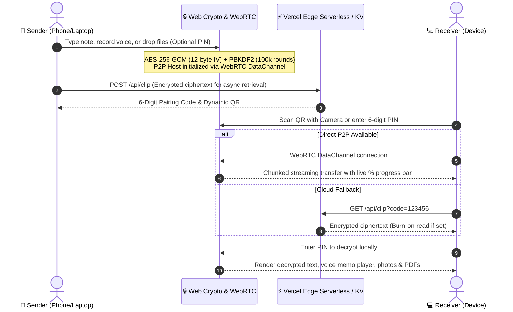

# ClipSync PRO 🚀

> High-performance, zero-friction universal cross-device clipboard, WebRTC streaming file transfer, and complete in-browser PDF & document powerhouse studio.

[](https://react.dev/)
[](https://www.typescriptlang.org/)
[](https://vitejs.dev/)
[](https://vitest.dev/)
[](https://developer.mozilla.org/en-US/docs/Web/API/SubtleCrypto)
[](https://developer.mozilla.org/en-US/docs/Web/Progressive_web_apps)
[](https://opensource.org/licenses/MIT)

---

## 📖 Overview

**ClipSync Pro** eliminates the daily friction of transferring text notes, code snippets, camera photos, voice memos, and documents between phones, laptops, and tablets. It combines client-side zero-knowledge encryption with sub-50ms instant generation, live QR camera scanning, WebRTC chunked peer-to-peer data streaming, and a full in-browser PDF & document studio.

No accounts, no tracking cookies, zero cloud uploads required for peer-to-peer transfers.



---

## ✨ Features & Architecture

### ⚡ Direct P2P WebRTC Chunked Binary Streaming
- **Zero-Cloud, Unlimited File Sizes**: Seamlessly stream large multi-megabyte files directly between devices over WebRTC DataChannels.
- **Packet Fragmentation & Pacing**: Overcomes browser SCTP buffer limitations using 16KB chunk slicing, backpressure pacing, and automated reassembly.
- **Live Transfer Progress**: Real-time progress bar (`⚡ Direct WebRTC P2P Streaming: 45%`) emitted to both sender and receiver.

### 🎙️ Voice Note & Audio Memo Recorder
- **In-Browser Audio Recording**: Record voice memos directly from your phone or laptop microphone using the native `MediaRecorder` API.
- **Real-Time Waveform Visualizer**: Living, animated sound frequency bars powered by the Web Audio API (`AnalyserNode`).
- **Inline Audio Player**: Decrypt and stream voice memos with interactive seek scrubbing, time duration counters, and one-click downloading.

### 📷 Live Camera QR Scanner
- **Camera-Based Instant Pairing**: Tap "Scan QR" to open an in-browser camera viewfinder with an animated laser scanner.
- **Native Barcode Detection**: Leverages the high-performance browser `BarcodeDetector` API with front/rear camera toggling.
- **Instant Auto-Fill**: Auto-parses QR codes and immediately executes clip retrieval without typing numbers manually.

### 📄 In-Browser Document & PDF Studio (iLovePDF Alternative)
A complete client-side document workstation powered by `pdf-lib`, `pdfjs-dist`, and `mammoth` with 100% private in-memory processing:
- **Merge PDFs**: Combine multiple PDF documents with custom ordering.
- **Split & Extract**: Extract specific page ranges (e.g., `1-3, 5, 8`) into a lightweight new document.
- **Rotate Pages**: Rotate sideways or upside-down pages by 90°, 180°, or 270° clockwise.
- **Photos to PDF**: Convert JPG, PNG, WEBP, and HEIC photos to multi-page PDFs with configurable margins and standard A4 / US Letter presets.
- **PDF to Images**: Render PDF pages onto hardware-accelerated canvas into high-resolution PNG images.
- **Word (.docx) to Clean Text & PDF**: Parse and convert Microsoft Word documents directly in your browser.
- **Rich Text / Notes to PDF**: Paginate and export notes with custom titles and line wrapping.

### 🔐 Zero-Knowledge Client-Side Encryption
- **AES-GCM 256-bit**: Native browser cryptography via `crypto.subtle`.
- **PBKDF2 Key Derivation**: 100,000 SHA-256 iterations with cryptographically random 16-byte salts.
- **Tamper-Evident Signatures**: Integrity check verifies every payload before decryption.

### 💻 Developer Code Viewer & Formatter
- **Syntax Display**: Monospace font with line numbers gutter toggle.
- **JSON Prettifier & Validator**: One-click indentation formatting.
- **Copy Options**: Instant "Copy Raw Code" or "Copy with Line Numbers".

### 📱 Progressive Web App (PWA)
- Fully installable on iOS (Safari Add to Home Screen) and Android (Chrome Install App) with standalone app shell, custom splash theme, and offline caching.

---

## 🏗️ Technology Stack

| Layer | Technology | Role |
|---|---|---|
| **Frontend** | React 19, TypeScript 5, Vite 8 | UI components, reactive state, fast HMR |
| **Styling** | Custom Glassmorphic CSS | Responsive Bento layout, dark/light themes |
| **Cryptography** | Web Crypto API (`SubtleCrypto`) | AES-GCM (256-bit), PBKDF2 (100k rounds) |
| **Networking** | PeerJS (WebRTC DataChannels) | Direct device-to-device streaming chunk protocol |
| **Audio Processing** | Web Audio API & MediaRecorder | Frequency analyzer, canvas waveform, audio playback |
| **Computer Vision** | `BarcodeDetector` API | Real-time camera QR detection and extraction |
| **PDF Manipulation** | `pdf-lib` & `pdfjs-dist` | In-browser PDF generation, merging, splitting, rendering |
| **Document Parsing**| `mammoth` | Client-side Word (.docx) extraction |
| **Testing** | Vitest | 13 comprehensive unit tests across crypto & documents |
| **Linting** | oxlint | Fast, strict Rust-based linter (0 errors, 0 warnings) |

---

## 🚀 Getting Started

### Prerequisites
- Node.js (v18 or newer)
- npm or pnpm

### Installation

```bash
# Clone the repository
git clone https://github.com/TanmayNileshShinde/clip-sync-pro.git

# Navigate into project directory
cd clip-sync-pro

# Install dependencies
npm install
```

### Running Locally

```bash
# Start local development server with Vite HMR
npm run dev
```

Visit `http://localhost:5173` in your browser.

---

## 🧪 Testing & Code Quality

```bash
# Run full Vitest test suite
npm test

# Run high-speed linter
npm run lint

# Compile TypeScript and build production bundle
npm run build
```

---

## 🌐 Deployment to Vercel

```bash
# Deploy to production in one step
npx vercel --prod
```

---

## 📄 License

Distributed under the **MIT License**. See `LICENSE` for more information.

---

## 👨‍💻 Author

**Tanmay Nilesh Shinde**
- GitHub: [@TanmayNileshShinde](https://github.com/TanmayNileshShinde)
- Email: tanmaynileshshinde@gmail.com
