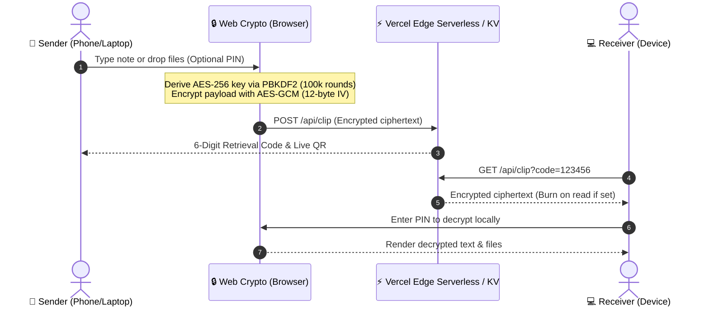

# ClipSync PRO 🚀

> High-performance, zero-friction universal cross-device clipboard & file transfer with client-side AES-GCM 256-bit encryption.

[](https://react.dev/)
[](https://www.typescriptlang.org/)
[](https://vitejs.dev/)
[](https://vitest.dev/)
[](https://developer.mozilla.org/en-US/docs/Web/API/SubtleCrypto)
[](https://opensource.org/licenses/MIT)

---

## 📖 Overview

**ClipSync Pro** solves the everyday friction of moving text notes, code snippets, camera photos, and documents between phones, laptops, and tablets. It combines client-side zero-knowledge encryption with sub-50ms instant generation, live QR code scanning, and automated image transcoding.

No accounts, no tracking cookies, and zero setup required.



---

## ✨ Features

### 🔐 Zero-Knowledge Client-Side Encryption
- **AES-GCM 256-bit** encryption performed directly in your browser using the native `crypto.subtle` API.
- Keys derived using **PBKDF2** with 100,000 SHA-256 iterations and unique 16-byte cryptographic salts.
- The server only ever stores encrypted ciphertext; passwords and encryption keys never leave your machine.

### 📸 Universal File & Photo Support
- **Multi-Attachment Bundling**: Attach screenshots, PDFs, photos, or documents alongside your text notes in a single 6-digit clip.
- **Automatic HEIC/HEIF Transcoding**: High-efficiency photos from iPhones are automatically transcoded to universal JPEG format on the fly.
- **Global Clipboard Paste**: Press `Ctrl+V` anywhere on the screen to instantly ingest screenshots into your outgoing clip.

### ⚡ Rapid Pairing & Sharing
- **6-Digit PIN Pairing**: Clean numeric code for quick manual typing.
- **Dynamic QR Code**: Scan with any smartphone camera to load the clip immediately.
- **Save QR as PNG**: One-click download of the generated QR code image.
- **Native Web Share**: Trigger your operating system's native share sheet with one tap.

### 🛠️ Developer Utility Suite
- **JSON Prettifier**: Detect and format JSON payloads with proper indentation.
- **Base64 Encoder / Decoder**: Instantly encode plaintext or decode base64 strings.
- **Whitespace Sanitizer**: Strip trailing whitespace and collapse redundant blank lines.
- **Case Converter**: Toggle between UPPERCASE and lowercase with a single click.
- **Clipboard Reader**: Pull content directly from your operating system clipboard into the editor.

### ⏱️ Configurable Lifespan & Self-Destruct
- **Burn After Read**: Permanently deletes the clip immediately after the first successful retrieval.
- **Automated Expiry**: Configure clips to automatically expire in 5 minutes, 1 hour, 24 hours, or 7 days.
- **Memory & Storage Caps**: Built-in 1,000-clip FIFO pruning to prevent memory exhaustion on serverless cold starts.

---

## 🏗️ Architecture & Security

| Layer | Technology | Details |
|---|---|---|
| **Frontend** | React 19, TypeScript, Vite | Zero runtime bloat, fast HMR |
| **Cryptography** | Web Crypto API (`SubtleCrypto`) | AES-GCM (256-bit), PBKDF2 (100k iterations, SHA-256) |
| **Transcoding** | Client-Side Canvas & HEIC Worker | In-memory canvas rendering, zero cloud compute cost |
| **Backend API** | Vercel Serverless Function (`api/clip.ts`) | Edge-ready Node runtime with security response headers |
| **Persistence** | Vercel KV / Upstash Redis (Optional) | Fallback to in-memory FIFO with automated expired pruning |
| **Testing** | Vitest | Comprehensive unit test suite for crypto and clip storage |

---

## 🚀 Getting Started

### Prerequisites
- Node.js (v18 or newer)
- npm or pnpm

### Installation

```bash
# Clone the repository
git clone https://github.com/TanmayNileshShinde/clip-sync-pro.git

# Navigate into the project directory
cd clip-sync-pro

# Install dependencies
npm install
```

### Running Locally

```bash
# Start local development server with Vite HMR
npm run dev
```

Visit `http://localhost:5173` in your browser.

---

## 🧪 Testing & Code Quality

ClipSync Pro includes a full test suite powered by **Vitest** and high-speed linting via **oxlint**.

```bash
# Run all unit tests
npm test

# Run tests in watch mode
npm run test:watch

# Run linter
npm run lint

# Build production bundle
npm run build
```

---

## 🌐 Deployment to Vercel

The application is pre-configured for Vercel deployment with serverless edge functions:

### Option 1: Vercel CLI (1-step)
```bash
npx vercel --prod
```

### Option 2: GitHub Integration
1. Push your repository to GitHub.
2. Import the project in the [Vercel Dashboard](https://vercel.com/new).
3. The build configuration (`npm run build` -> `dist`) is recognized automatically.

### Optional Cloud Persistence (Vercel KV / Redis)
ClipSync Pro runs out-of-the-box using serverless in-memory storage. For multi-region persistent storage:
1. In your Vercel Project Dashboard, navigate to **Storage**.
2. Create a **KV** database and connect it to your project.
3. The serverless handler will automatically detect `KV_REST_API_URL` and `KV_REST_API_TOKEN` and persist clips seamlessly.

---

## 📄 License

Distributed under the **MIT License**. See `LICENSE` for more information.

---

## 👨‍💻 Author

**Tanmay Nilesh Shinde**
- GitHub: [@TanmayNileshShinde](https://github.com/TanmayNileshShinde)
- Email: tanmaynileshshinde@gmail.com
